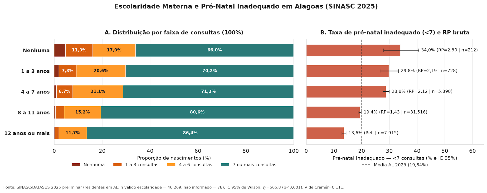
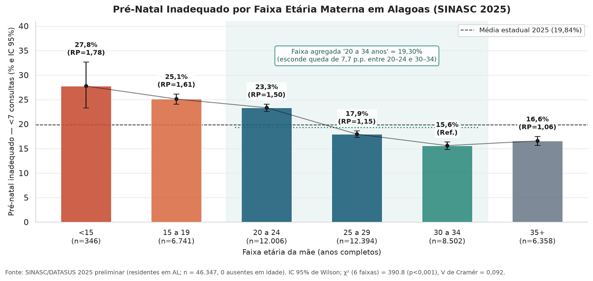
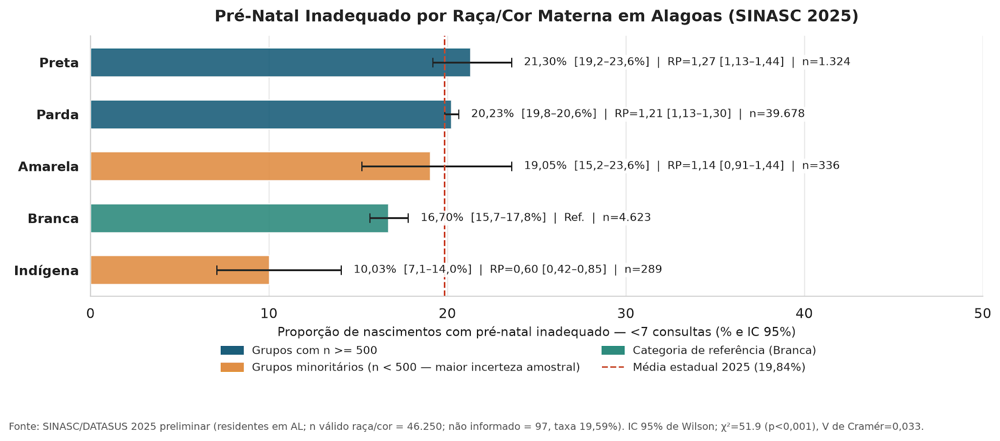
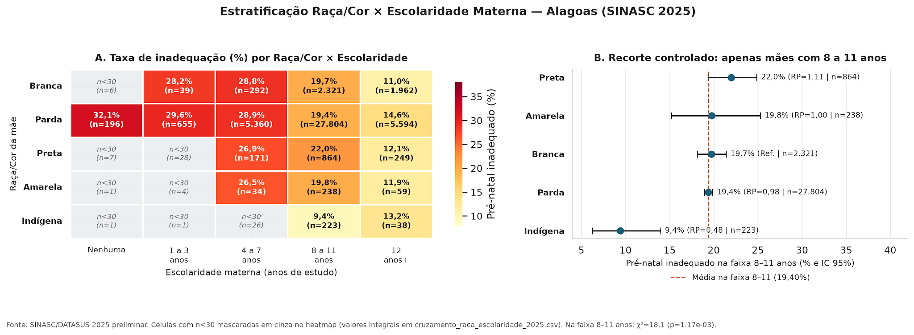
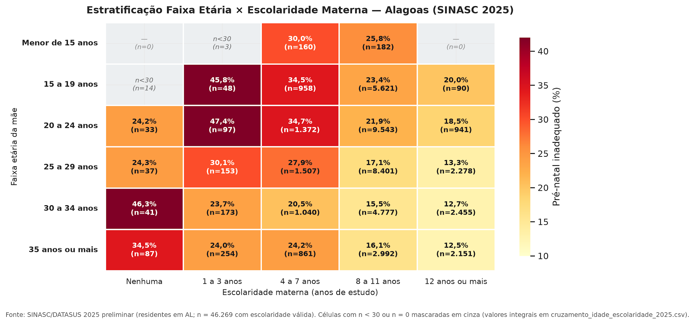
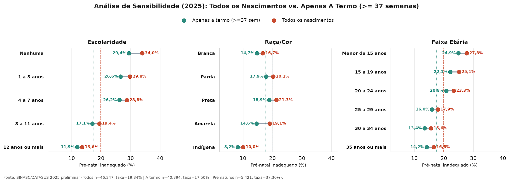
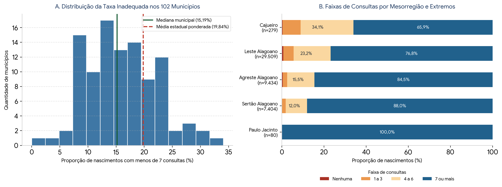
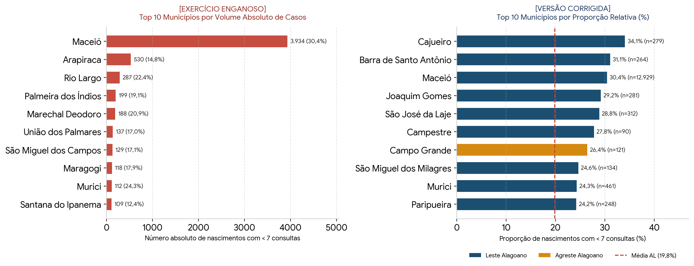
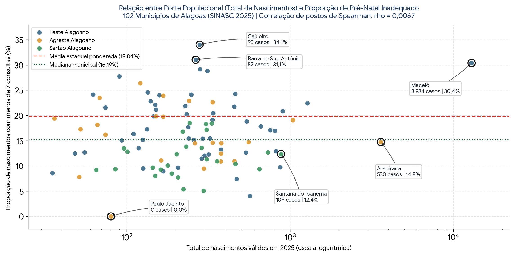
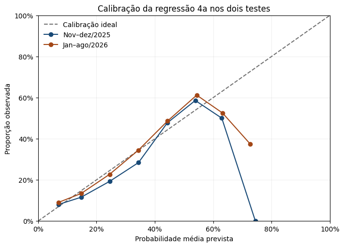

# Desigualdades no pré-natal em Alagoas em 2025

**Universidade Federal de Alagoas · Instituto de Computação**
Projeto AB2 · Introdução à Ciência de Dados · Inteligência Artificial
Professora Cristina Tenório · Maceió, 22/11/2026

**Equipe:** Emerson Ferreira Barros, Pedro Lucas Leite da Silva, Weverton Deyvison da Silva, Diego Matheus Bastos de Oliveira e Joao Marcos de Lima Monezi.

Esta versão em Markdown preserva o conteúdo analítico do relatório entregue. A [apresentação interativa](https://joaomonezi.github.io/analise_pre-natal-2025-al/) também inclui as análises complementares feitas após a apresentação.

## Sumário

1. [Introdução](#1-introdução)
2. [Dados e tratamento](#2-dados-e-tratamento)
3. [Fatores socioeconômicos e demográficos](#3-fatores-socioeconômicos-e-demográficos)
4. [Contraste territorial](#4-contraste-territorial)
5. [Modelo preditivo](#5-modelo-preditivo)
6. [Conclusão geral](#6-conclusão-geral)
7. [Referências](#referências)

# 1 INTRODUÇÃO

Este trabalho investiga como as desigualdades na frequência do pré-natal se manifestam entre grupos maternos e municípios. O recorte abrange os nascidos vivos de mães residentes nos 102 municípios de Alagoas em 2025, segundo o SINASC/DATASUS. O cadastro do IBGE identifica o município de residência.

Pergunta 1. Como escolaridade, raça/cor e faixa etária da mãe se associam à proporção de nascidos vivos com menos de sete consultas?

Pergunta 2. Como essa proporção varia entre os municípios e de que maneira a contagem absoluta distorce a comparação?

Pergunta 3. Quanto o perfil socioeconômico e demográfico da mãe e o município de residência ajudam a prever menos de sete consultas?

# 2 DADOS E TRATAMENTO

A Rede Alyne é a rede do SUS que organiza o cuidado à mulher e à criança durante a gestação, o parto e o pós-parto. No pré-natal da Unidade Básica de Saúde, a rede prevê pelo menos sete consultas. No SINASC, as categorias nenhuma, 1 a 3 e 4 a 6 consultas formam o grupo com menos de sete. A categoria seguinte reúne sete ou mais. O indicador expressa a frequência registrada de consultas, uma das dimensões do cuidado.

Dos 46.398 registros de 2025, 51 tinham faixa de consultas ignorada. Eles foram analisados separadamente na auditoria. Na base analítica, 9.193 dos 46.347 registros com informação válida (19,84%) tinham menos de sete consultas. A segunda prévia de 2026 é usada no teste complementar da pergunta preditiva.

O notebook consolidado gera a base descritiva, a base enriquecida para a pergunta 1, os arquivos da auditoria e a base preditiva. Os dados são apresentados de forma agregada.

# 3 FATORES SOCIOECONÔMICOS E DEMOGRÁFICOS

De que forma escolaridade, raça/cor e faixa etária da mãe se associam à proporção de nascimentos com menos de sete consultas em Alagoas em 2025?

## 3.1 Coleta, Limpeza, Métodos e Ética

### 3.1.1 Coleta e preparação dos dados

Os microdados originais foram obtidos do Sistema de Informações sobre Nascidos Vivos (**SINASC/DATASUS**, recorte SINASC_AL_2025_residencia.csv, com 46.398 registros e 62 colunas) e enriquecidos com a malha oficial do IBGE (IBGE_municipios_Alagoas.json, 102 municípios, cruzados pelo prefixo de 6 dígitos de CODMUNRES).

Adotou-se o critério epidemiológico de **município de residência da mãe em Alagoas** (CODMUNRES iniciado por 27), resultando no seguinte funil para 2025:

1.  **Base bruta (SINASC_AL_2025_residencia.csv):** 46.398 registros (100% residentes em Alagoas e nascidos em 2025: 46.031 nascidos em AL e 367 nascidos em outros estados; 102 municípios válidos, sem códigos municipais não mapeados).

2.  **Registros com CONSULTAS == 9 (Ignorado):** 51 registros (0,11%), removidos da base analítica e preservados anonimizados Dados Tratados/auditoria_consultas_ignoradas_2025.csv.

3.  **Base analítica final (base_tratada_SINASC_AL_2025_enriquecida.csv):** **46.347 registros válidos** e **31 colunas**, com **0 divergências** entre a faixa categórica CONSULTAS e a contagem exata CONSPRENAT.

4.  **Padronização de ausentes:** códigos de ignorado (9 em escolaridade, estado civil, gravidez, gestação e Kotelchuck; 99 em contagem exata e mês de início) foram convertidos para NaN, mantendo-se ausentes de escolaridade (78; 0,17%) e raça/cor (97; 0,21%) na base tratada e reportados explicitamente.

### 3.1.2 Ética, privacidade e reprodutibilidade

Em conformidade com os requisitos éticos do projeto e com a LGPD, nenhum dado pessoal ou identificador indireto foi publicado na base tratada: foram descartados identificadores internos e de cartório (contador, NUMEROLOTE, CODESTAB, CODCART, NUMREGCART), datas e horários exatos (DTNASC, HORANASC, DTNASCMAE, DTCADASTRO, DTRECEBIM, DTRECORIGA, DTDECLARAC, DTULTMENST), ocupação detalhada (CODOCUPMAE) e desfechos neonatais fora do escopo.

A preparação dos dados, as tabelas agregadas e as figuras desta pergunta são reproduzidas no notebook consolidado, nas etapas de limpeza e da Pergunta 1.

### 3.1.3 Abordagem estatística

Para responder à pergunta exploratória e inferencial, empregaram-se:

1.  **Proporções com Intervalo de Confiança de 95% (IC 95%) de Wilson**, mais confiável que o intervalo clássico de Wald em grupos com n reduzido.

2.  **Razão de Prevalência (RP) bruta com IC 95% pelo método de Katz (log-normal)** frente à categoria de referência — preferida ao *Odds Ratio* por se tratar de estudo transversal com desfecho comum (~20%), cenário em que o *Odds Ratio* superestima a magnitude da associação.

3.  **Teste Qui-quadrado de independência (**$`\chi^{2}`$**)** combinado ao **V de Cramér** para comparar o tamanho de efeito entre fatores (evitando depender apenas do p-valor em amostra grande).

4.  **Análise estratificada** (*Raça/Cor × Escolaridade* e *Faixa Etária × Escolaridade*, mascarando visualmente nos heatmaps células com n \< 30 e preservando todos os valores nos CSVs) e **análise de sensibilidade** restrita a nascimentos a termo ($`\geq 37`$ semanas) para controlar o confundidor prematuridade.

## 3.2 Resposta Direta à Pergunta de Pesquisa

Em Alagoas em 2025, **19,84% dos nascidos vivos** (9.193 de 46.347 registros válidos) tiveram pré-natal inadequado (\<7 consultas): 0,56% sem nenhuma consulta (259), 3,82% com 1 a 3 consultas (1.770) e 15,46% com 4 a 6 consultas (7.164).

Os três fatores analisados associam-se de forma estatisticamente significativa ($`p < 0,001`$) ao pré-natal inadequado, mas com **intensidades e mecanismos distintos**:

| **Fator materno** | $`n`$ **válido** | $`\chi^{2}`$ | $`p`$**-valor** | **V de Cramér** | **Interpretação da força relativa** |
|:---|---:|---:|---:|---:|:---|
| **Escolaridade (ESCMAE2010, 6 níveis)** | 46.269 | 686,68 | $`3,7 \times 10^{- 146}`$ | **0,122** | Maior associação (recorte por etapa de ensino) |
| **Escolaridade (ESCMAE, 5 faixas)** | 46.269 | 565,77 | $`4,0 \times 10^{- 121}`$ | **0,111** | Fator principal mais forte em anos de estudo |
| **Faixa etária (6 faixas detalhadas)** | 46.347 | 390,80 | $`2,8 \times 10^{- 82}`$ | **0,092** | Segunda associação mais forte |
| *Faixa etária (4 faixas obstétricas)* | *46.347* | *180,50* | $`6,9 \times 10^{- 39}`$ | *0,062* | *Perde sinal ao agrupar 20–34 anos* |
| **Raça/Cor materna (5 categorias)** | 46.250 | 51,86 | $`1,5 \times 10^{- 10}`$ | **0,034** | Significativa, porém ~3× mais fraca que escolaridade e idade |

Associação dos fatores maternos com menos de sete consultas

Em resumo: **escolaridade materna** e **faixa etária** (sobretudo maternidade abaixo dos 25 anos) concentram a maior parte da desigualdade no acesso às 7 consultas mínimas, somam-se de forma severa quando ocorrem juntas e mantêm seus gradientes mesmo após excluir partos prematuros. Já na dimensão de **raça/cor**, mães Pretas e Pardas registram prevalência bruta ~21%–28% superior à de Brancas, mas esse hiato praticamente desaparece entre Brancas e Pardas na faixa majoritária de 8 a 11 anos de estudo, enquanto mães Indígenas destacam-se com a menor taxa da base preliminar (10,03%).

## 3.3 Principais Achados

### 3.3.1 Escolaridade materna: fator mais forte e gradiente monotônico

Quanto menor a escolaridade da mãe, maior a proporção de pré-natal inadequado ao longo de todas as cinco faixas (Dados Tratados/consultas_por_escolaridade_2025.csv):

| **Escolaridade (ESCMAE)** | $`n`$ | **% da base** | **Inadequado (\<7)** | **IC 95% (Wilson)** | **RP bruta (IC 95% Katz)** |
|:---|---:|---:|---:|---:|---:|
| Nenhuma | 212 | 0,46% | **33,96%** | \[27,92% – 40,57%\] | **2,50** \[2,06 – 3,04\] |
| 1 a 3 anos | 728 | 1,57% | **29,81%** | \[26,60% – 33,23%\] | **2,20** \[1,94 – 2,49\] |
| 4 a 7 anos | 5.898 | 12,73% | **28,76%** | \[27,61% – 29,92%\] | **2,12** \[1,98 – 2,27\] |
| 8 a 11 anos | 31.516 | 68,00% | **19,40%** | \[18,97% – 19,84%\] | **1,43** \[1,35 – 1,52\] |
| 12 anos ou mais (Ref.) | 7.915 | 17,08% | **13,58%** | \[12,84% – 14,35%\] | **1,00** (Ref.) |
| *Não informado* | *78* | *0,17%* | *23,08%* | *\[15,13% – 33,56%\]* | *—* |

Proporção com menos de sete consultas por escolaridade materna

Mães sem escolaridade têm **2,50 vezes** a prevalência de pré-natal inadequado observada em mães com 12 anos ou mais de estudo. O salto de 4 a 7 anos (28,76%) para 8 a 11 anos (19,40%) — faixa que reúne 68% das mães alagoanas — representa queda de **9,36 pontos percentuais**, seguida de nova redução de 5,82 pontos ao alcançar 12 anos ou mais (13,58%). A inadequação severa (0 a 3 consultas) cai de **16,04%** em *Nenhuma* para **1,92%** em *12 anos ou mais*.

### 3.3.2 Faixa etária materna: curva em "L" e gradiente oculto em 20–34 anos

A relação entre idade materna (IDADEMAE, 11 a 57 anos, sem ausentes) e pré-natal inadequado desenha uma curva decrescente até 30–34 anos, estabilizando-se a partir de 35 anos (Dados Tratados/consultas_por_faixa_etaria_2025.csv):

| **Faixa etária (6 faixas)** | $`n`$ | **% da base** | **Inadequado (\<7)** | **IC 95% (Wilson)** | **RP bruta (IC 95% Katz)** |
|:---|---:|---:|---:|---:|---:|
| Menor de 15 anos | 346 | 0,75% | **27,75%** | \[23,29% – 32,69%\] | **1,78** \[1,49 – 2,12\] |
| 15 a 19 anos | 6.741 | 14,54% | **25,11%** | \[24,09% – 26,16%\] | **1,61** \[1,51 – 1,72\] |
| 20 a 24 anos | 12.006 | 25,90% | **23,33%** | \[22,58% – 24,09%\] | **1,50** \[1,41 – 1,59\] |
| 25 a 29 anos | 12.394 | 26,74% | **17,94%** | \[17,28% – 18,63%\] | **1,15** \[1,08 – 1,22\] |
| 30 a 34 anos (Ref.) | 8.502 | 18,34% | **15,60%** | \[14,84% – 16,38%\] | **1,00** (Ref.) |
| 35 anos ou mais | 6.358 | 13,72% | **16,56%** | \[15,67% – 17,50%\] | **1,06** \[0,99 – 1,14\] |

Um achado metodológico importante deste estudo é que o recorte tradicional em 4 faixas de risco obstétrico agrupa **71% das mães** no bloco único 20 a 34 anos (taxa agregada de 19,30%), ocultando um **gradiente interno de 7,73 pontos percentuais** entre adultas jovens de 20 a 24 anos (23,33%) e mulheres de 30 a 34 anos (15,60%). Desagregar essa faixa elevou o V de Cramér de 0,062 para **0,092**.

### 3.3.3 Raça/cor materna e o efeito da estratificação por escolaridade

Na análise bruta ([<u>consultas_por_racacor_2025.csv</u>](https://www.docstomarkdown.pro/Dados%20Tratados/consultas_por_racacor_2025.csv)), mães **Pretas** (**21,30%**, n=1.324, RP = 1,28 \[1,13–1,44\]) e **Pardas** (85,6% da base; **20,23%**, n=39.678, RP = 1,21 \[1,13–1,30\]) apresentam prevalência superior à de mães **Brancas** (**16,70%**, n=4.623). Mães **Amarelas** (19,05%, n=336) não diferem significativamente de Brancas (IC 95% da RP: \[0,91–1,44\]), enquanto mães **Indígenas** registram a menor taxa da base (**10,03%**, n=289; IC 95%: \[7,08%–14,04%\]; RP = 0,60 \[0,42–0,85\]).

Ao estratificar **Raça/Cor por Escolaridade** ([<u>cruzamento_raca_escolaridade_2025.csv</u>](https://www.docstomarkdown.pro/Dados%20Tratados/cruzamento_raca_escolaridade_2025.csv)), observa-se o papel central da composição educacional:

1.  Em Alagoas em 2025, **42,4%** das mães Brancas têm 12+ anos de estudo, frente a **14,1%** das Pardas e **18,8%** das Pretas.

2.  Quando fixamos a escolaridade na faixa majoritária **8 a 11 anos** (n = 31.450; 68% da base), **Brancas (19,73%, n=2.321) e Pardas (19,37%, n=27.804; RP = 0,98) praticamente empatam** (assim como Amarelas, 19,75%). O teste qui-quadrado global dentro dessa faixa ($`\chi^{2} = 18,12`$, $`p = 0,001`$, V = 0,024) é puxado sobretudo pela taxa muito baixa registrada em **Indígenas (9,42%, n=223)** e pela taxa mais alta em **Pretas (21,99%, n=864)**.

3.  Já na faixa de **12 anos ou mais**, a diferença entre **Brancas (10,96%, n=1.962)** e **Pardas (14,60%, n=5.594)** permanece evidente (3,64 p.p.), sugerindo que, no topo da escolaridade, ainda persistem desigualdades que vão além dos anos de estudo.

### 3.3.4 Efeito combinado: faixa etária × escolaridade

O cruzamento entre faixa etária e escolaridade ([<u>cruzamento_idade_escolaridade_2025.csv</u>](https://www.docstomarkdown.pro/Dados%20Tratados/cruzamento_idade_escolaridade_2025.csv)) evidencia forte acumulação de vulnerabilidades:

1.  Mães de 15 a 19 anos com 1 a 3 anos (45,8%, n=48) e de 20 a 24 anos com 1 a 3 anos (47,4%, n=97) alcançam quase **quatro vezes** a taxa de mães de 30+ anos com 12+ anos de estudo (**12,5%–12,7%**).

2.  Mesmo mantendo a escolaridade fixa em 8 a 11 anos, a taxa cai continuamente conforme aumenta a idade: **25,8%** (\<15) → **23,4%** (15–19) → **21,9%** (20–24) → **17,1%** (25–29) → **15,5%** (30–34). Ou seja, idade jovem e baixa escolaridade exercem efeitos próprios que se somam.

### 3.3.5 Robustez frente à prematuridade (análise de sensibilidade)

Partos prematuros (\< 37 semanas, n = 5.421) encerram a gestação mais cedo e reduzem o tempo disponível para completar 7 consultas, registrando **37,30%** de pré-natal inadequado frente a **17,50%** nos nascimentos a termo ($`\geq 37`$ semanas, n = 40.894) — mais que o dobro.

Ao restringir a análise apenas aos **nascimentos a termo** ([<u>sensibilidade_prematuridade_2025.csv</u>](https://www.docstomarkdown.pro/Dados%20Tratados/sensibilidade_prematuridade_2025.csv)), todas as taxas caem em média ~2 a 4 pontos percentuais, mas **todos os gradientes e razões de prevalência permanecem preservados**:

1.  **Escolaridade (Nenhuma vs. 12+ anos):** mantém **RP = 2,48** (29,45% vs. 11,89%).

2.  **Faixa etária (\<15 vs. 30–34):** a RP sobe ligeiramente de 1,78 para **1,85** (24,91% vs. 13,45%); 15–19 mantém **RP = 1,65** e 20–24 chega a **RP = 1,55**.

3.  **Raça/Cor (Preta e Parda vs. Branca):** permanecem estáveis (**RP = 1,28** e **1,21** em nascimentos a termo), assim como **Indígena** (**RP = 0,56**, 8,24% vs. 14,74%).

Isso confirma que as associações socioeconômicas e demográficas identificadas **não são mero artefato mecânico da prematuridade**.

## 3.4 Limitações

1.  **Estudo observacional transversal (associação** $`\neq`$ **causalidade):** os resultados descrevem padrões populacionais em registros administrativos, não permitindo inferir relação causal direta.

2.  **Ausência de renda e barreiras de acesso no SINASC:** o sistema não registra renda domiciliar, vínculo com plano privado, distância até unidades básicas de saúde ou transporte. Escolaridade e raça/cor funcionam como marcadores estruturais, mas não esgotam a dimensão socioeconômica.

3.  **Quantidade de consultas não mede toda a qualidade do pré-natal:** atingir 7 ou mais consultas é um critério quantitativo mínimo. Na própria base de 2025, **2.380 mães (6,41%)** entre as 37.154 que realizaram 7+ consultas só iniciaram o acompanhamento após o 3º mês de gestação (MESPRENAT \>= 4), sendo classificadas como **Inadequado** pelo Índice de Kotelchuck. Além disso, o SINASC não registra exames realizados, vacinação ou qualidade clínica das consultas.

4.  **Qualidade do preenchimento e dados ignorados:** os **51 registros** com CONSULTAS == 9 (0,11%) têm impacto global desprezível — nos cenários extremos de 0% ou 100% de inadequação, a taxa estadual variaria apenas entre **19,81% e 19,92%**. Os 78 registros sem escolaridade (0,17%; taxa 23,08%) e os 97 sem raça/cor (0,21%; taxa 19,59%) representam frações muito pequenas da base, mas continuam sendo pontos de atenção para a qualidade do registro.

5.  **Incerteza amostral em subgrupos menores:** categorias com menos de 500 observações (*Amarela*, *Indígena*, *Menor de 15 anos*, *Nenhuma escolaridade*) produzem intervalos de confiança largos. Nos cruzamentos duplos, células com n \< 30 foram mascaradas nos heatmaps para evitar interpretações instáveis, mantendo-se integralmente disponíveis nas tabelas CSV.

6.  **Caráter preliminar da base de 2025:** os microdados do SINASC 2025 ainda estão sujeitos a retroalimentação e consolidação tardia pelo DATASUS; achados em subgrupos pequenos (em especial a baixa taxa observada em *Indígena*, n=289) devem ser acompanhados após o fechamento definitivo da base.

# 4 CONTRASTE TERRITORIAL

Como a proporção de nascimentos com menos de sete consultas varia entre os 102 municípios de Alagoas e como os números absolutos alteram essa comparação?

## 4.1. Metodologia, Tratamento dos Dados e Registros Ignorados

A partir dos 46.398 registros originais de nascidos vivos residentes em Alagoas (SINASC_AL_2025_residencia.csv, 62 colunas), o pipeline reproduzível (etapa de limpeza do notebook consolidado) removeu identificadores individuais, datas exatas e variáveis pós-parto, além dos 51 casos sem informação válida de consultas (código 9). A base tratada (base_tratada_SINASC_AL_2025.csv, 20 colunas) consolidou 46.347 nascimentos válidos, integrados sem perdas à malha do IBGE (102 municípios, 13 microrregiões e 3 mesorregiões). No estado, 80,16% (37.154) atingiram 7 ou mais consultas e 19,84% (9.193) tiveram pré-natal inadequado: 15,46% (7.164) com 4 a 6 consultas, 3,82% (1.770) com 1 a 3 e 0,56% (259) sem nenhuma consulta.

**Auditoria dos registros ignorados (CONSULTAS = 9):** Os 51 registros ignorados (0,11% da base original) foram auditados separadamente para identificar suas causas e implicações:

- **Concentração institucional (4 de 157 CNES):** 100% das omissões ocorreram em apenas 4 unidades: Hospital Nossa Senhora da Guia em Maceió (45 casos, 88,2%), Hospital Regional de Palmares/PE (3 casos de residentes em Campestre e Colônia Leopoldina), UPA 24h Galba Novaes (2) e UPA Dr. Cláudio Costa (1). Em UPAs (outros estabelecimentos de saúde), a taxa de omissão (1,91%) foi 18,3 vezes maior do que em hospitais (0,10%), ocorrendo de forma contínua nos 12 meses de 2025.

- **Ausência não aleatória (MNAR) e causas operacionais:** O grupo ignorado exibe vulnerabilidade maior que o próprio grupo inadequado: 33,3% com até 7 anos de estudo (contra 13,1% nas adequadas), 72,5% de parto vaginal, 3,92% com Apgar no 5º minuto abaixo de 7 (contra 0,73%), omissão em cascata do mês de início do pré-natal (90,2%) e atraso médio de 82,0 dias na digitação da Declaração de Nascido Vivo (contra 37,4 dias nas adequadas). Isso aponta para partos de urgência sem cartão da gestante e atraso administrativo na unidade.

- **Análise de sensibilidade:** Mesmo no cenário pessimista (todos os 51 ignorados sendo inadequados), o impacto é pequeno em Alagoas (+0,09 p.p., para 19,92%) e em Maceió (+0,23 p.p., para 30,65%), mas expressivo em municípios pequenos como Campestre (+1,57 p.p., de 27,78% para 29,35%).

## 4.2. Variação Territorial nos 102 Municípios de Alagoas

A proporção municipal de pré-natal inadequado varia de 0,00% em Paulo Jacinto (0 de 80 nascimentos) a 34,05% em Cajueiro (95 de 279). A mediana municipal é de 15,19% e a média simples é de 16,02%, com desvio padrão de 6,42 pontos percentuais, coeficiente de variação (dispersão relativa em torno da média) de 40,08% e amplitude interquartil (faixa dos 50% municípios centrais) de 8,99 p.p. (entre 11,17% e 20,16%). Apenas 28 municípios (27,5%) superam a média estadual ponderada (19,84%), elevada pelo peso de Maceió (27,90% dos nascimentos e 42,79% dos casos inadequados do estado, com taxa local de 30,43%).

| **Mesorregião (IBGE)** | **Municípios** | **Nascimentos** | **Casos \< 7** | **Taxa Ponderada** | **Mediana Mun.** | **Mín. / Máx.** |
|:---|---:|---:|---:|---:|---:|---:|
| **Leste Alagoano** | 52 | 29.509 | 6.839 | 23,18% | 17,51% | 4,06% / 34,05% |
| **Agreste Alagoano** | 24 | 9.434 | 1.463 | 15,51% | 15,49% | 0,00% / 26,45% |
| **Sertão Alagoano** | 26 | 7.404 | 891 | 12,03% | 11,14% | 5,08% / 18,52% |
| **Alagoas (Total)** | **102** | **46.347** | **9.193** | **19,84%** | **15,19%** | **0,00% / 34,05%** |

O mapa regional revela claro gradiente leste para oeste: o Leste Alagoano concentra 9 dos 10 piores municípios e lidera nas microrregiões de Maceió (28,19%) e Mata Alagoana (21,18%). Já o Sertão Alagoano tem a melhor cobertura relativa (12,03%), com destaque para as microrregiões de Santana do Ipanema (11,35%) e Alagoana do Sertão do São Francisco (11,40%), além de municípios como Canapi (5,08%) e Senador Rui Palmeira (5,41%).

*Figura 1: (A) Distribuição municipal da taxa de pré-natal inadequado (n = 102); (B) Faixas de consultas em barras empilhadas 100% por mesorregião e extremos municipais. Fonte: SINASC/DATASUS 2025 e IBGE.*

## 4.3. Distorção por Números Absolutos (Exercício Enganoso vs. Corrigido)

**Prova Estatística:** Como o volume anual de nascimentos varia 369 vezes (de 35 em Pindoba a 12.929 em Maceió), a correlação linear de Pearson entre nascimentos e casos absolutos inadequados é de r = 0,9868. Ao normalizar para proporção (%), a correlação de postos de Spearman cai para rho = 0,0067, comprovando que o porte populacional não explica o risco relativo.

- **Falso alarme em polos populosos:** Arapiraca (2º absoluto, 530 casos) e Santana do Ipanema (10º absoluto, 109 casos) parecem críticos na contagem bruta, mas têm taxas de 14,77% e 12,39%, melhores que a média estadual (19,84%) e a mediana municipal (15,19%).

- **Invisibilidade de municípios menores vulneráveis:** Cajueiro (34,05%), Barra de Santo Antônio (31,06%), Joaquim Gomes (29,18%) e São José da Laje (28,85%) possuem proporções equivalentes ou superiores à de Maceió (30,43%), mas somem do Top 10 absoluto por terem menos de 100 casos cada.

- **Complementaridade na gestão:** Apenas Maceió e Murici aparecem nos dois rankings Top 10. Na saúde pública, a proporção identifica onde o risco e a desigualdade são maiores, enquanto o volume absoluto dimensiona equipes e orçamento.

*Figura 2: Exercício obrigatório de visualização enganosa (Entrega 5). À esquerda, ranking distorcido pelo volume absoluto; à direita, versão corrigida por proporção relativa (%) com média estadual. Fonte: SINASC/DATASUS 2025 e IBGE.*

| **Pos.** | **Enganoso (Absoluto)** | **Casos** | **Taxa (%)** | **Corrigido (Proporção)** | **Mesorregião** | **Nasc. (n)** | **Taxa (%)** |
|---:|:---|---:|---:|:---|:---|---:|---:|
| 1º | Maceió | 3.934 | 30,43% | Cajueiro | Leste Alagoano | 279 | 34,05% |
| 2º | Arapiraca | 530 | 14,77% | Barra de Santo Antônio | Leste Alagoano | 264 | 31,06% |
| 3º | Rio Largo | 287 | 22,44% | Maceió | Leste Alagoano | 12.929 | 30,43% |
| 4º | Palmeira dos Índios | 199 | 19,13% | Joaquim Gomes | Leste Alagoano | 281 | 29,18% |
| 5º | Marechal Deodoro | 188 | 20,89% | São José da Laje | Leste Alagoano | 312 | 28,85% |

*Figura 3: Dispersão em escala logarítmica entre total de nascimentos e proporção inadequada nos 102 municípios (Spearman rho = 0,0067). Fonte: SINASC/DATASUS 2025 e IBGE.*

## 4.4. Limitações Metodológicas e Conclusão

- **Quantidade não mede qualidade clínica:** O corte de 7 consultas avalia apenas a frequência mínima, sem capturar início no 1º trimestre, realização de exames, vacinação ou resolutividade assistencial.

- **Denominadores pequenos e ética:** Em cidades com menos de 100 nascimentos (como Pindoba, Mar Vermelho e Paulo Jacinto), poucos casos geram grande oscilação percentual anual, exigindo séries plurianuais. Os dados são anonimizados na origem, sem identificadores individuais na base tratada, e 100% reprodutíveis pelos notebooks entregues.

**Conclusão:** A análise dos 46.347 nascimentos válidos de 2025 confirma acentuada desigualdade territorial em Alagoas (de 0,00% em Paulo Jacinto a 34,05% em Cajueiro), com maior vulnerabilidade concentrada no Leste Alagoano (23,18%) frente ao Agreste (15,51%) e ao Sertão (12,03%). Demonstrou-se ainda que rankings absolutos espelham o tamanho populacional (r = 0,9868), distorcendo o diagnóstico regional ao superestimar polos como Arapiraca (14,77%) e ocultar municípios menores com déficit severo, além de revelar que os 51 registros ignorados representam falhas localizadas de preenchimento em 4 unidades associadas a perfis de maior vulnerabilidade.

# 5 MODELO PREDITIVO

Quanto o perfil socioeconômico e demográfico da mãe e o município de residência ajudam a prever menos de sete consultas? Nesta seção, o histórico obstétrico também é avaliado como um bloco de variáveis.

## 5.1 Método

### 5.1.1 Preparação e seleção de variáveis

Reutilizamos o CSV tratado pelo grupo, acrescentando o mês de nascimento. Dos 46.398 nascidos vivos de mães residentes em Alagoas em 2025, 51 tinham consultas ignoradas. O alvo vale 1 para zero a seis consultas e 0 para sete ou mais.

Dividimos 2025 por mês de nascimento para testar períodos posteriores ao ajuste. Janeiro a agosto serviu para ajustar, setembro e outubro para validar e novembro e dezembro para testar. Gestações de blocos diferentes podem ter ocorrido nos mesmos meses.

As entradas simulam o que se sabe no início da gestação. Prematuridade, duração final, peso e tipo de parto são observados depois. As consultas definem ou conferem o alvo.

### 5.1.2 Modelos e critérios de avaliação

A regressão logística mede o ganho dos blocos de variáveis. Com as mesmas entradas, a árvore rasa testa se cortes e interações ajudam. A referência constante usa a taxa do treino. Essas comparações atendem à pergunta da AB2.

Brier e Log Loss medem erro das probabilidades. ROC-AUC e precisão média avaliam a ordenação por risco. Priorizamos a sensibilidade nos alertas. Prever sete ou mais para todos daria 83,04% de acurácia na validação e zero casos detectados.

### 5.1.3 Tratamento das variáveis

O pipeline aprende as transformações no ajuste. A idade recebe imputação pela mediana e é padronizada na regressão. A árvore usa anos, pois os cortes dependem da ordem. As categorias viram indicadores 0/1. As faixas do histórico agrupam valores raros.

## 5.2 Resultados

### 5.2.1 Escolha do modelo e do limiar

Nos 7.490 registros de validação, comparamos as variáveis do perfil isoladas e em conjunto. Depois medimos o ganho de acrescentar município e histórico.

| **Modelo ou bloco acrescentado**  | **Brier** | **Log Loss** | **ROC-AUC** |
|:----------------------------------|----------:|-------------:|------------:|
| Referência constante              |   0,14252 |      0,46060 |     0,50000 |
| Perfil materno completo           |   0,13875 |      0,44808 |     0,61930 |
| Município de residência           |   0,13372 |      0,43083 |     0,68186 |
| Número de gestações anteriores    |   0,13092 |      0,42307 |     0,70269 |
| Histórico ampliado, versão 4a     |   0,12976 |      0,41954 |     0,71077 |
| Raça/cor acrescentada à versão 4a |   0,12972 |      0,41945 |     0,71111 |
| Árvore rasa com as entradas da 4a |   0,13557 |      0,43805 |     0,64760 |

Tabela 1 – Comparação na validação de setembro e outubro de 2025

Fonte: elaboração do grupo com dados do SINASC.

O município trouxe o maior ganho. Raça/cor pouco alterou as métricas após incluir o histórico ampliado e ficou na avaliação por grupo. A regressão 4a superou a árvore com as mesmas entradas.

Fixamos o maior limiar que identificava pelo menos 90% dos casos na validação para reduzir os alertas falsos entre as regras que atingiam a meta. Na regressão 4a, ele ficou em 11,88%.

### 5.2.2 Resultados no total

Reajustamos com janeiro a outubro para testar novembro e dezembro de 2025. Para o teste retrospectivo de 2026, ajustamos com todo 2025. Excluímos 62 registros de 2026 sem alvo válido.

| **Período**                 | **Registros** | **Observada** | **Prevista** |
|:----------------------------|--------------:|--------------:|-------------:|
| Novembro e dezembro de 2025 |         7.228 |        17,32% |       19,91% |
| Janeiro a agosto de 2026    |        28.664 |        19,60% |       19,76% |

Tabela 2 – Proporção observada e estimativa média por período

Fonte: elaboração do grupo com dados do SINASC.

A estimativa excedeu o observado em 2,59 pontos percentuais em 2025 e 0,16 ponto em 2026.

### 5.2.3 Resultados por grupo

A tabela destaca as faixas de escolaridade com maior volume. O notebook também mostra as demais faixas e a avaliação por raça/cor.

| **Escolaridade** | **n 2025** | **Obs. 2025** | **Prev. 2025** | **n 2026** | **Obs. 2026** | **Prev. 2026** |
|:---|---:|---:|---:|---:|---:|---:|
| 4 a 7 anos | 840 | 25,95% | 29,11% | 3.148 | 27,51% | 28,54% |
| 8 a 11 anos | 4.926 | 16,63% | 19,68% | 20.021 | 19,41% | 19,57% |
| 12 anos ou mais | 1.319 | 12,81% | 13,71% | 4.972 | 14,20% | 13,76% |

Tabela 3 – Frequência observada e prevista por escolaridade materna

Fonte: elaboração do grupo com dados do SINASC.

A proporção foi maior na faixa de 4 a 7 anos nos dois testes. A diferença pode orientar uma investigação sobre barreiras de acesso ao pré-natal, considerando volume, oferta local e outras evidências.

### 5.2.4 Desempenho por registro

A regressão reduziu o Brier nos dois testes. O limiar sinalizou cerca de 70% dos registros. A mudança de período e o reajuste podem ter contribuído para a queda de sensibilidade.

| **Métrica**                        |  **Nov–dez/2025** |  **Jan–ago/2026** |
|:-----------------------------------|------------------:|------------------:|
| Brier da referência / regressão    | 0,14410 / 0,13162 | 0,15757 / 0,14335 |
| Log Loss da referência / regressão | 0,46380 / 0,42600 | 0,49477 / 0,45439 |
| ROC-AUC da regressão               |            0,6992 |            0,6983 |
| Precisão média                     |            35,14% |            37,82% |
| Sensibilidade no limiar fixo       |            85,22% |            86,13% |
| Precisão dos alertas               |            21,12% |            23,89% |
| Falsos positivos                   |             3.984 |            15.413 |

Tabela 4 – Métricas por registro e desempenho do alerta

Fonte: elaboração do grupo com dados do SINASC.

Exemplo hipotético. Uma previsão individual de 25% ultrapassaria o limiar de 11,88% e poderia motivar revisão pela equipe.

### 5.2.5 Calibração por faixa de risco

<figure>

<figcaption>
Figura 1 – Probabilidade média prevista e frequência observada
</figcaption>
</figure>

Fonte: elaboração do grupo com dados do SINASC.

Na faixa de 60% a 70%, a média prevista ficou perto de 63% nos dois testes. A proporção observada foi 50,0% em 2025 e 52,5% em 2026. Na faixa de 70% a 80%, havia só 2 registros em 2025 e 8 em 2026. A baixa contagem torna esses pontos instáveis e limita a interpretação da superestimação nas faixas mais altas.

## 5.3 Interpretação e limitações

O perfil materno, o município e o histórico ajudaram a estimar probabilidades, com ganho moderado nos dois testes. As probabilidades são o resultado principal. A regra de alerta mostra o volume de falsos positivos associado à prioridade de detectar casos.

A avaliação retrospectiva cobre nascidos vivos registrados. A declaração de nascimento aproxima as informações do início da gestação. Gestações mais curtas podem ter menos tempo para acumular consultas, e a contagem representa uma dimensão do cuidado. A prévia de 2026 tem cobertura parcial e pode ser revisada.

# 6 CONCLUSÃO GERAL

Em Alagoas, em 2025, 19,84% dos nascidos vivos com informação de pré-natal tinham menos de sete consultas registradas. A proporção variou entre grupos maternos, com a diferença mais marcada por escolaridade. Entre municípios, a comparação por proporção revelou diferenças que o volume absoluto ocultava. Na validação, a ROC-AUC passou de 0,500 na referência para 0,619 com o perfil materno e 0,682 com a inclusão do município. Os resultados ajudam a localizar desigualdades na frequência registrada de consultas. A qualidade clínica do pré-natal exige outros indicadores.

# REFERÊNCIAS

- **Ministério da Saúde (Brasil).** *Sistema de Informações sobre Nascidos Vivos (SINASC) — Estrutura e Dicionário de Dados*. CGIAE/DASNT/SVS/DATASUS.

- **IBGE.** *Malha e Divisão Territorial dos Municípios de Alagoas* (IBGE_municipios_Alagoas.json).

- **Barros, A. J. D., & Hirakata, V. N. (2003).** Alternatives for logistic regression in cross-sectional studies: an empirical comparison of models that directly estimate the prevalence ratio. *BMC Medical Research Methodology*, 3, 21. DOI: [<u>10.1186/1471-2288-3-21</u>](https://www.docstomarkdown.pro/Dados%20Tratados/consultas_por_racacor_2025.csv).

- **Coutinho, L. M. S., Scazufca, M., & Menezes, P. R. (2008).** Métodos para estimar razão de prevalência em estudos de corte transversal. *Revista de Saúde Pública*, 42(6), 992–998. DOI: [<u>10.1590/S0034-89102008000600003</u>](https://www.docstomarkdown.pro/Dados%20Tratados/cruzamento_raca_escolaridade_2025.csv).

- **Wilson, E. B. (1927).** Probable Inference, the Law of Succession, and Statistical Inference. *Journal of the American Statistical Association*, 22(158), 209–212. DOI: [<u>10.1080/01621459.1927.10502953</u>](https://www.docstomarkdown.pro/Dados%20Tratados/cruzamento_idade_escolaridade_2025.csv).

- **Brown, L. D., Cai, T. T., & DasGupta, A. (2001).** Interval Estimation for a Binomial Proportion. *Statistical Science*, 16(2), 101–133. DOI: [<u>10.1214/ss/1009213286</u>](https://www.docstomarkdown.pro/Dados%20Tratados/sensibilidade_prematuridade_2025.csv).

- **Katz, D., Baptista, J., Azen, S. P., & Pike, M. C. (1978).** Obtaining Confidence Intervals for the Risk Ratio in Cohort Studies. *Biometrics*, 34(3), 469–474. DOI: [<u>10.2307/2530610</u>](media/image8.png).

- **Kotelchuck, M. (1994).** An Evaluation of the Kessner Adequacy of Prenatal Care Index and a Proposed Adequacy of Prenatal Care Utilization Index. *American Journal of Public Health*, 84(9), 1414–1420. DOI: [<u>10.2105/ajph.84.9.1414</u>](media/image10.png).

[<u>Ministério da Saúde. SINASC 2026, segunda prévia.</u>](https://dadosabertos.saude.gov.br/dataset/sistema-de-informacao-sobre-nascidos-vivos-sinasc/resource/6bb82548-4f33-4eb0-8e32-e1be63b4413b)

[<u>SiBi/UFAL. Manual para normalização de trabalhos acadêmicos.</u>](https://www.repositorio.ufal.br/handle/123456789/10627)

Ministério da Saúde. Portaria de Consolidação GM/MS nº 3, Anexo II, art. 7º. Rede Alyne.

https://bvsms.saude.gov.br/bvs/saudelegis/gm/2017/prc0003_03_10_2017_comp.html
